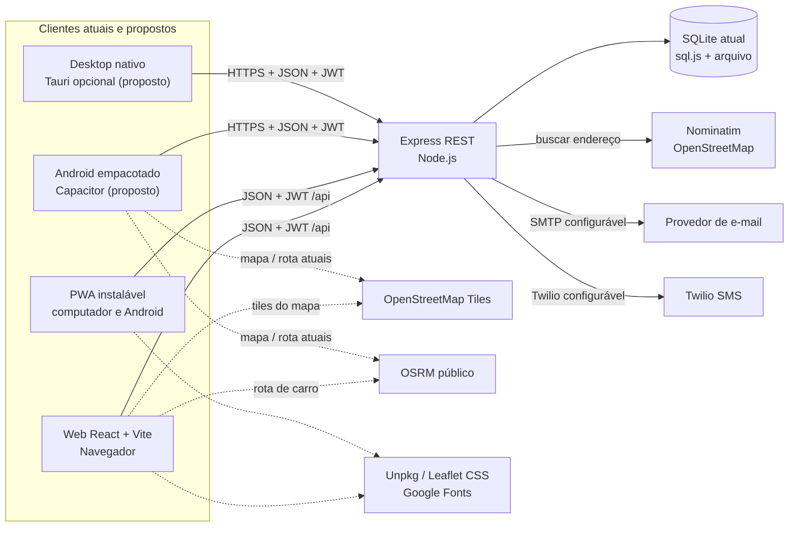
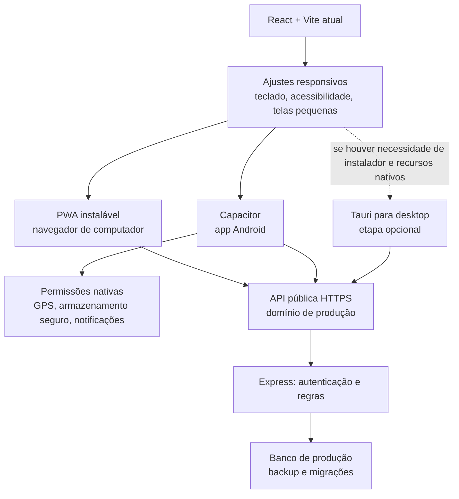

# Relatório de APIs, arquitetura e plano para computador e Android

**Projeto:** Pardela

**Data da revisão:** 25/11/2026
**Escopo:** inventário das APIs internas e externas, leitura estática dos fluxos, execução dos testes existentes e build do frontend. Este documento registra achados e recomendações; não altera a implementação do produto.

## 1. Resumo executivo

O Pardela já tem uma base funcional de aplicação web: frontend React/Vite, API REST em Express, autenticação JWT, papéis de usuário/empresa/admin, persistência SQLite via `sql.js` e mapas Leaflet/OpenStreetMap.

| Área | Resultado desta revisão |
|---|---|
| API interna | 46 handlers de negócio e 1 health check encontrados (47 rotas declaradas) |
| Testes do servidor | **10 passaram; 0 falharam** |
| Build do frontend | **Concluído com sucesso** |
| E-mail/SMS | Fluxos existem, mas dependem de credenciais SMTP ou Twilio; não foi feito envio real |
| Mapas/rotas | Integrações encontradas no código; disponibilidade e limites dos provedores não foram testados ao vivo |
| Aplicativo Android | Não há wrapper Android/Capacitor ou projeto nativo no repositório |
| Aplicativo de computador | A versão web já pode ser usada no navegador; não há instalador desktop nativo |

**Prioridades antes de uma versão pública:**

1. Corrigir e testar o envio de mensagens de empresa para administrador: há uma atribuição a uma variável declarada como constante.
2. Configurar e testar um provedor real de e-mail ou SMS para recuperação de senha e verificação de conta.
3. Decidir explicitamente se administradores podem ler e enviar mensagens de qualquer coleta.
4. Definir hospedagem, HTTPS, política de backups e banco de dados para produção.
5. Desenvolver a experiência instalável: PWA para computador e Android via Capacitor são o caminho de menor retrabalho.

## 2. Como a verificação foi feita e limites

- Inventário por leitura do código de `workspace/server/src/`, `workspace/client/src/` e configurações relacionadas.
- Execução de `npm test` em `workspace/server`: **10/10 testes passaram**.
- Execução de `npm run build` em `workspace/client`: build de produção concluído.
- O health check também é exercitado pela suíte de rotas.
- Não foram enviados e-mails/SMS, não foram feitas chamadas de teste a Nominatim/OSRM/Google/tiles e não foram auditados dados reais de produção.
- O arquivo `.env.example` contém campos vazios para SMTP e Twilio; credenciais e funcionamento dos provedores precisam ser confirmados no ambiente de implantação, sem compartilhar segredos.

## 3. Diagrama da arquitetura e das integrações atuais

O desenho proposto mantém **uma API e uma regra de negócio** para web, Android e computador. O aplicativo não deve criar um banco independente nem replicar regras de coleta no dispositivo. A API atual usa `/api` e, em desenvolvimento, o Vite encaminha essas chamadas para `localhost:3001`.

## 4. Inventário das APIs internas

Base local de desenvolvimento: `http://localhost:3001/api`. O frontend usa JSON e, após login, envia `Authorization: Bearer <JWT>`. Os tokens expiram em sete dias. A lista abaixo combina os handlers encontrados nas rotas do servidor; `:id` e `:companyId` são parâmetros de URL.

### Saúde e estatísticas públicas

| Método e rota | Acesso | Uso |
|---|---|---|
| `GET /api/health` | Público | Verifica se o processo da API responde |
| `GET /api/stats` | Público | Números resumidos usados pela página inicial |

### Autenticação — `/api/auth`

| Método e rota | Acesso | Uso |
|---|---|---|
| `POST /api/auth/register/user` | Público | Inicia cadastro e solicita código de verificação |
| `POST /api/auth/register/user/resend` | Público | Reenvia código de cadastro |
| `POST /api/auth/register/user/verify` | Público | Confirma código, cria usuário e devolve JWT |
| `POST /api/auth/register/company` | Público | Cadastra empresa, inicialmente pendente de aprovação |
| `POST /api/auth/login` | Público | Login de usuário/admin ou empresa, conforme o papel selecionado |
| `GET /api/auth/materials` | Público | Lista os materiais aceitos |
| `POST /api/auth/password-reset/request` | Público | Solicita recuperação de senha com resposta genérica |
| `POST /api/auth/password-reset/confirm` | Público | Confirma código e define nova senha |
| `POST /api/auth/password-change/request` | Usuário autenticado | Solicita código para alteração de senha |
| `POST /api/auth/password-change/confirm` | Usuário autenticado | Confirma código e altera a senha |

Os códigos são de seis dígitos, armazenados como hash, expiram em dez minutos e têm limite de tentativas. O envio é integrado por SMTP para e-mail e Twilio para SMS, conforme o contato principal da conta.

### Usuários e endereços — `/api/users`

Todas exigem JWT de usuário.

| Método e rota | Uso |
|---|---|
| `GET /api/users/me` | Perfil e endereços do usuário autenticado |
| `PUT /api/users/me` | Atualiza nome; contato e senha usam fluxos próprios |
| `POST /api/users/addresses` | Adiciona endereço e tenta obter coordenadas |
| `PUT /api/users/addresses/:id` | Atualiza endereço |
| `POST /api/users/addresses/:id/default` | Define endereço padrão |
| `DELETE /api/users/addresses/:id` | Remove endereço |

### Empresas — `/api/companies`

Todas exigem JWT; as rotas marcadas como empresa/usuário também validam o papel.

| Método e rota | Acesso | Uso |
|---|---|---|
| `GET /api/companies/me` | Empresa | Consulta perfil da empresa autenticada |
| `PUT /api/companies/me` | Empresa | Atualiza perfil, endereço, materiais e, opcionalmente, senha |
| `DELETE /api/companies/me` | Empresa | Exclui a própria conta |
| `GET /api/companies/list` | Usuário | Lista empresas aprovadas, priorizando a cidade do usuário |

### Coletas e chat da coleta — `/api/collections`

Todas exigem JWT. As rotas de listagem, dashboard, criação e status exigem também o papel indicado.

| Método e rota | Acesso | Uso |
|---|---|---|
| `POST /api/collections` | Usuário | Cria solicitação de coleta |
| `GET /api/collections/mine` | Usuário | Lista coletas próprias |
| `GET /api/collections` | Empresa aprovada | Lista coletas disponíveis/atribuídas com filtros |
| `GET /api/collections/dashboard` | Empresa aprovada | Indicadores da empresa |
| `GET /api/collections/user-dashboard` | Usuário | Indicadores e próximas coletas |
| `PUT /api/collections/:id/status` | Empresa aprovada | Aceita, agenda, inicia, conclui, recusa ou cancela conforme as transições |
| `GET /api/collections/:id` | JWT; propriedade verificada para usuário/empresa | Consulta detalhes de uma coleta |
| `GET /api/collections/:id/messages` | JWT; propriedade verificada para usuário/empresa | Consulta mensagens e marca as recebidas como lidas |
| `POST /api/collections/:id/messages` | JWT; propriedade verificada para usuário/empresa | Envia mensagem relacionada à coleta |

A aceitação da coleta usa uma atualização condicional para evitar que duas empresas obtenham a mesma solicitação; o perdedor recebe conflito `409`.

### Notificações — `/api/notifications`

Todas exigem JWT e limitam os dados ao papel/dono, com exceção do papel admin, que vê o conjunto global.

| Método e rota | Uso |
|---|---|
| `GET /api/notifications` | Últimas notificações |
| `GET /api/notifications/unread-count` | Contagem de não lidas |
| `PUT /api/notifications/:id/read` | Marca uma notificação como lida |
| `PUT /api/notifications/read-all` | Marca as notificações do escopo como lidas |

### Mensagens admin ↔ empresa — `/api/messages`

Todas exigem JWT; o papel é conferido em cada operação.

| Método e rota | Acesso | Uso |
|---|---|---|
| `GET /api/messages/conversations` | Admin ou empresa | Lista conversas do admin ou conversa da empresa |
| `GET /api/messages/company/:companyId` | Admin | Carrega conversa específica e marca mensagens da empresa como lidas |
| `POST /api/messages` | Admin ou empresa | Envia mensagem ao interlocutor |
| `GET /api/messages/unread-count` | Admin ou empresa | Conta mensagens não lidas |

### Administração — `/api/admin`

Todas exigem JWT de admin.

| Método e rota | Uso |
|---|---|
| `GET /api/admin/companies` | Lista empresas |
| `GET /api/admin/companies/pending` | Lista empresas pendentes |
| `POST /api/admin/companies/:id/approve` | Aprova empresa |
| `POST /api/admin/companies/:id/reject` | Rejeita e remove empresa pendente |
| `DELETE /api/admin/companies/:id` | Remove empresa |
| `GET /api/admin/stats` | Indicadores administrativos |
| `GET /api/admin/users` | Lista usuários |
| `DELETE /api/admin/users/:id` | Remove usuário, exceto admin |

## 5. APIs e serviços externos encontrados

| Serviço | Uso observado | Requer chave no código? | Observações |
|---|---|---:|---|
| **Nominatim / OpenStreetMap** | Busca de endereço para coordenadas no servidor; conversão reversa de GPS para endereço no cliente | Não | Dados de endereço/localização são enviados ao serviço. Há timeout de 8 s no caminho do servidor; não foi identificada fila/cache compartilhado nem limite global de requisições. Seguir a política oficial e monitorar limites. |
| **OpenStreetMap Tile Server** | Imagens-base dos mapas Leaflet | Não | Atribuição OpenStreetMap está visível. O código usa `https://{s}.tile.openstreetmap.org/...`; conferir política atual e ajustar para a forma de URL suportada pelo provedor antes de crescer o tráfego. |
| **OSRM público** | Traça caminho de carro entre empresa e endereço da coleta | Não | O cliente chama `router.project-osrm.org` diretamente. O servidor público de demonstração não deve ser tratado como serviço com SLA ou capacidade garantida para produção. |
| **Google Maps URL** | Abre pesquisa/local em nova aba/janela | Não | É um link de pesquisa (`maps/search/?api=1`), não uso do SDK/Maps API; não há chave do Google Maps no código. |
| **Google Fonts** | Carrega DM Sans pelo CSS do Google | Não | Recurso visual externo; pode ser auto-hospedado para reduzir dependência externa e exposição de metadados de conexão. |
| **Unpkg** | Carrega o CSS do Leaflet no HTML | Não | CDN externo de recurso estático; é possível servir o CSS localmente a partir do pacote instalado. |
| **SMTP / Nodemailer** | Envia códigos por e-mail | Credenciais SMTP | Integração preparada, mas precisa de host, porta, usuário, senha e remetente válidos. |
| **Twilio** | Envia códigos por SMS | Credenciais Twilio | Integração preparada, mas precisa de SID, token e número remetente válidos. |
| **Geolocation API do navegador** | Solicita localização do dispositivo após permissão explícita | Não | Requer contexto seguro (HTTPS, exceto localhost) e permissão do usuário. Android também precisa de permissões nativas ao ser empacotado. |
| **Fetch API / localStorage** | Comunicação HTTP e armazenamento local do JWT no frontend | Não | APIs do próprio navegador/WebView, não serviços externos. O token atual fica no `localStorage` da aplicação web. |

### Limites relevantes das integrações de mapa

- As chamadas de geocodificação e tiles dependem de serviços públicos e políticas que podem mudar; consultar as políticas oficiais antes de publicar ou aumentar volume.
- A geocodificação de endereço pode falhar sem impedir algumas operações, deixando coordenadas nulas. A interface precisa explicar que o mapa/rota pode não aparecer e permitir correção manual.
- A rota OSRM é chamada no frontend sem timeout explícito. Falhas são tratadas como rota indisponível, mas não há telemetria de taxa de falha.
- Para Android e desktop, considerar mover geocodificação e cálculo de rota para adaptadores no backend. Isso centraliza timeout, cache, observabilidade e escolha de provedor; as tiles podem continuar sendo servidas por um provedor de mapas compatível com a licença e a política escolhidas.
- Localização precisa e endereço são dados pessoais. A publicação deve documentar finalidade, consentimento, retenção e compartilhamento com provedores de mapa.

## 6. Feedback e achados priorizados

### P1 — Corrigir o envio de mensagem da empresa para o admin

Em `workspace/server/src/routes/messages.js`, `receiverId` é extraído com `const` e, no ramo da empresa, recebe uma nova atribuição com o ID do admin. Em JavaScript isso lança erro em tempo de execução; o caminho de resposta da empresa tende a terminar em erro `500` em vez de registrar a mensagem.

**Ação:** usar uma variável local mutável com nome explícito para o destinatário efetivo e adicionar teste de integração para os dois sentidos (admin → empresa e empresa → admin). Os testes atuais não cobrem esse fluxo.

### P1 — Configurar e testar entrega de códigos

Os fluxos de recuperação e verificação chamam SMTP ou Twilio, mas esses serviços só enviam quando as respectivas variáveis de ambiente estão definidas. O exemplo de configuração deixa essas credenciais vazias. O pedido de recuperação responde genericamente por segurança; se o provedor falhar, o cliente não sabe que nenhum código foi entregue.

**Ação:** configurar um canal em ambiente de teste; validar remetente, entregabilidade, limites, expiração, reenvio e recuperação ponta a ponta. Manter a resposta pública genérica para não revelar se uma conta existe, mas registrar métricas/alertas operacionais sem gravar código ou segredo.

### P1/P2 — Definir o acesso admin a coletas e chats

`GET /api/collections/:id`, `GET /api/collections/:id/messages` e `POST /api/collections/:id/messages` verificam propriedade para usuário e empresa, mas não definem explicitamente o comportamento do admin. Como o router só exige autenticação, um JWT admin não é rejeitado nesses handlers e não passa pelas verificações de dono usadas para os outros papéis.

**Ação:** decidir se o admin deve consultar/moderar esses dados. Depois, autorizar esse papel deliberadamente, registrando auditoria quando necessário, ou rejeitá-lo explicitamente. Adicionar testes para user, empresa não atribuída e admin.

### P2 — Não transformar falha de estatística em sucesso com zeros

`workspace/server/src/routes/stats.js` retorna `200` com estatísticas zeradas quando ocorre erro de banco. Isso parece uma resposta válida e esconde incidentes. A página inicial também faz `fetch` diretamente e não verifica `response.ok`.

**Ação:** devolver erro HTTP quando a consulta falhar e mostrar estado de indisponibilidade no frontend, distinguindo zero real de erro.

### P2 — Melhorar confiabilidade e privacidade das integrações de mapa

As chamadas a Nominatim não têm cache/fila compartilhados e podem enviar endereço ou localização a um terceiro. OSRM é chamado diretamente do navegador e usa infraestrutura pública de demonstração. O sucesso das operações não deve depender exclusivamente desses serviços.

**Ação:** centralizar os adaptadores externos, aplicar limites e timeouts consistentes, cachear resultados de geocodificação quando permitido, manter entrada manual e definir um provedor/contrato adequado para produção. Rever as políticas atuais de Nominatim e tiles.

### P2 — Planejar persistência para produção

O banco atual é `sql.js` carregado em memória e exportado para arquivo a cada escrita. É uma solução simples e útil para desenvolvimento/baixa concorrência, mas exige estratégia de backup, restauração e escrita segura; não é automaticamente adequada a múltiplos processos/instâncias.

**Ação:** antes de aumentar tráfego, testar concorrência e recuperação de falha. Para produção, considerar PostgreSQL gerenciado ou uma implementação SQLite com persistência/concurrency/backup bem definidos. Criar migrações reproduzíveis e testar restauração.

### P2 — Fortalecer entrega/segurança operacional

- O frontend guarda JWT no `localStorage`; em apps nativos, usar armazenamento seguro do sistema operacional, não copiar essa decisão automaticamente para o Android.
- A API tem controle de tentativas em memória em rotas de autenticação; isso não compartilha contagem entre instâncias e reinicia com o processo. Para produção, usar rate limit durável/distribuído e observar tentativas.
- A API emite alguns cabeçalhos de segurança, mas a implantação ainda precisa definir HTTPS obrigatório, domínio, política de conteúdo, logs sem dados sensíveis, monitoramento, backup e rotação de segredos.
- Notificações são atualizadas por polling a cada 15 segundos (inclui contagem e lista para sons). Isso é simples, mas aumenta chamadas com muitos clientes; considerar push no Android e uma estratégia adequada para web.

### P3 — Completar validação automatizada

O backend tem testes de OTP, migração e alguns fluxos de rota. O build do cliente passa, mas não há script de teste frontend no `package.json`. O sucesso do build não substitui testes de interface, acessibilidade, autorização e integrações.

**Ação:** adicionar testes focados para mensagens, autorização por papel, recuperação de senha com adaptadores falsos, transições concorrentes de coleta e fluxos críticos do cliente. Manter os provedores externos mockados em CI.

## 7. Plano recomendado para computador e Android

### Objetivo de arquitetura

Reutilizar a interface React existente e a API atual. Android e computador devem consumir o mesmo backend HTTPS; autenticação, validações e estados de coleta ficam centralizados no servidor.

### Etapa 0 — Preparar a API para produção

1. Corrigir o defeito de mensagens e fechar as decisões de autorização descritas neste relatório.
2. Configurar e provar ao menos um canal de e-mail/SMS em homologação.
3. Hospedar a API em domínio próprio com HTTPS e CORS restrito aos domínios oficiais.
4. Definir banco, migrações, backup/restore, logs, monitoramento e processo de rotação de segredos.
5. Criar uma URL de API configurável por ambiente (`local`, `homologação`, `produção`) no cliente.

### Etapa 1 — Computador: PWA primeiro

1. Tornar a interface responsiva e validar os fluxos de usuário, empresa e admin em resoluções comuns.
2. Adicionar `manifest` (nome, ícones, cores e modo de exibição) e service worker.
3. Permitir instalação pelo navegador em Windows/macOS/Linux; entregar atualizações pelo site.
4. Cachear apenas recursos estáticos. Não armazenar páginas privadas, dados de endereço ou respostas da API em cache offline por padrão.
5. Garantir uma tela amigável sem internet e links externos funcionando sem depender de pop-ups bloqueados.

Uma PWA é a recomendação inicial para computador: mantém uma única base de código e não exige empacotar instaladores em uma primeira entrega. Se houver necessidade posterior de integração profunda com o sistema operacional, instalador próprio ou recursos nativos, avaliar **Tauri** como invólucro desktop. Electron é alternativa madura, mas tende a distribuir um runtime maior.

### Etapa 2 — Android: empacotar a web com Capacitor

1. Integrar Capacitor ao frontend React/Vite e criar o projeto Android.
2. Apontar o app para a API HTTPS de produção; não embutir `.env`, senha de banco, JWT secret ou credenciais de terceiros no APK.
3. Solicitar permissão de localização apenas quando a pessoa iniciar uma ação de GPS; manter preenchimento manual alternativo.
4. Usar armazenamento seguro nativo para tokens e limpar a sessão no logout/expiração.
5. Definir notificações: manter polling inicialmente ou integrar Firebase Cloud Messaging (FCM) com tokens por dispositivo e preferências do usuário.
6. Tratar permissões negadas, conexão lenta, perda de rede, rotação de tela, teclado virtual e retomada do app.
7. Testar em emulador e aparelhos reais, Android suportado pela publicação, GPS negado/concedido e rede móvel instável.
8. Preparar assinatura, versionamento, política de privacidade, ícones, screenshots e publicação na Google Play.

**Por que Capacitor:** permite reaproveitar boa parte da aplicação React já existente e adicionar plugins nativos quando necessário. React Native seria uma opção se a interface precisasse ser reconstruída como componentes nativos; não é a primeira escolha para minimizar retrabalho neste projeto.

### Etapa 3 — Desktop nativo, se a PWA não bastar

Depois de validar a PWA, empacotar a mesma interface com Tauri apenas se houver requisito claro para instalador, integração com sistema de arquivos/notificações ou operação específica offline. O aplicativo nativo continua dependente da API central para contas, coletas e mensagens; não deve distribuir credenciais privilegiadas nem abrir uma porta local para contornar o backend.

### Critérios mínimos de aceite para os aplicativos

- Login, logout, recuperação de senha e expiração de sessão testados em cada plataforma.
- Autorização conferida no servidor, não apenas por ocultar botões.
- GPS somente após consentimento; fluxo manual disponível.
- Mapas com atribuição, comportamento de erro e provedor conforme políticas de uso.
- Sem dados pessoais em cache offline ou logs sem uma decisão explícita de privacidade.
- Build reproduzível, teste automatizado, matriz de aparelhos/navegadores e procedimento de atualização.
- HTTPS em produção; certificados autoassinados apenas em desenvolvimento/testes controlados.

## 8. Referências do repositório

- API HTTP, CORS e health check: [`workspace/server/src/index.js`](workspace/server/src/index.js)
- Autenticação JWT: [`workspace/server/src/auth.js`](workspace/server/src/auth.js)
- Banco e persistência: [`workspace/server/src/db.js`](workspace/server/src/db.js)
- Envio de códigos: [`workspace/server/src/otp.js`](workspace/server/src/otp.js)
- Rotas de mensagens: [`workspace/server/src/routes/messages.js`](workspace/server/src/routes/messages.js)
- Rotas de coletas: [`workspace/server/src/routes/collections.js`](workspace/server/src/routes/collections.js)
- Estatísticas públicas: [`workspace/server/src/routes/stats.js`](workspace/server/src/routes/stats.js)
- Geocodificação: [`workspace/server/src/geocode.js`](workspace/server/src/geocode.js)
- Cliente HTTP e armazenamento de sessão: [`workspace/client/src/api.js`](workspace/client/src/api.js)
- Polling de notificações: [`workspace/client/src/auth.js`](workspace/client/src/auth.js)
- Geolocalização do navegador: [`workspace/client/src/components/AddressFields.js`](workspace/client/src/components/AddressFields.js)
- Tiles de mapa: [`workspace/client/src/components/MapView.js`](workspace/client/src/components/MapView.js) e [`workspace/client/src/pages/CollectionMap.js`](workspace/client/src/pages/CollectionMap.js)
- Roteamento externo: [`workspace/client/src/pages/MyCollections.js`](workspace/client/src/pages/MyCollections.js)
- Documentação existente da API interna: [`texto-API.md`](texto-API.md)
- Documentação existente das APIs externas: [`APIS_EXTERNAS.md`](APIS_EXTERNAS.md)

> As documentações existentes devem ser revisadas junto com futuras alterações: por exemplo, a implementação atual do OSRM usa `overview=simplified`, e o envio empresa → admin precisa de teste de integração. Políticas de serviços de terceiros também devem ser confirmadas diretamente nos sites oficiais antes da publicação.
